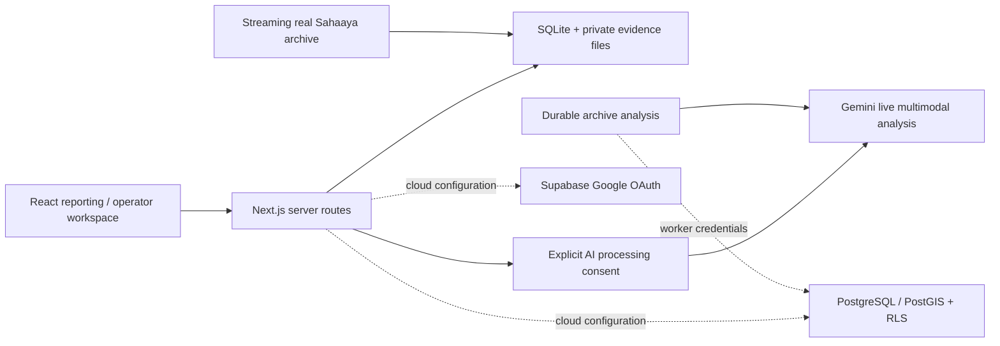

# CivicLens · Bengaluru

An evidence-first civic grievance and infrastructure triage application, built with Next.js 16, React 19, TypeScript, MapLibre GL, AI SDK 7 and Workflow SDK 5. Local reporting works without cloud credentials. Supabase/PostGIS migrations and Google OAuth are included for your own hosting setup.

## Run locally

Requires **Node.js 24** (the local backend uses `node:sqlite`).

```powershell
npm ci
Copy-Item .env.example .env.local
npm run data:import
npm run dev
```

Open **http://127.0.0.1:3000**. On macOS/Linux use `cp .env.example .env.local`.

The import streams 5,000 real Sahaaya records from the public [Bengaluru citizen grievances dataset](https://github.com/Vonter/bbmp-citizen-grievances). It requires internet access and saves records into ignored `.data/civiclens.sqlite`. Subsequent local browsing/reporting works against that database; the street basemap still requires internet.

```sh
npm test
npm run typecheck
npm run build
npm run test:integration
npm start
```

Build uses Next.js's webpack compiler for reliable Workflow SDK integration. Integration tests run the actual production server against a separate, randomly named database under `.data/verification/`; their clearly identified test records never enter the citizen workspace.

## What works locally

- Database-backed archive metrics, search/category filtering, case inspection and source attribution.
- Bengaluru street map. Imported records have ward names, not exact coordinates: no fabricated archive pins are drawn. Your own geolocated reports appear as private markers.
- Private browser receipt sessions: cryptographically random HttpOnly cookies, with only hashed tokens stored server-side. This is explicitly anonymous local ownership, **not** simulated Google sign-in.
- Create real reports with verified Bengaluru coordinate bounds and a tracking ID. Five submissions per receipt per hour.
- Private photo/audio attachments (5 MB maximum), microphone recording capped at 60 seconds, protected playback and downloads.
- Local review queues and audited transitions: Submitted → Acknowledged → In progress → Handoff prepared/Resolution proposed → Closed or Reopened. A resolution proposal requires image evidence. Local actions do not represent government acceptance or work.
- Handoff packet export without exact coordinates or private attachment bytes.
- Optional live Gemini analysis of text, photographs and English audio, with evidence IDs, transcription, uncertainty and explicit consent. **Requires your own Gemini key. No fabricated AI output is provided.**

## Data integrity

The source dataset is maintained by Vonter under ODbL and attributes its upstream records to Bengaluru Smart City Limited/Sahaaya. The imported window is historical, not an authoritative real-time government feed. Original dates and source statuses are preserved. Distinct ward labels are not counted as current official wards. Source closure does not prove a field repair.

No citizen examples, made-up coordinates, fabricated dashboard counts or canned model responses ship in the application. Automated test inputs are isolated from the running citizen database.

## Configuration

Keep all credentials in ignored `.env.local`; commit only `.env.example`.

- `CIVIC_LOCAL_MODE=true`: local receipt sessions and SQLite. The supplied start scripts bind to loopback. **Do not publicly expose this local workspace mode.**
- `GEMINI_API_KEY`: your Google AI Studio key for optional real inference. `GEMINI_MODEL` defaults to `gemini-3.8-flash`; verify availability and quota in your account.
- `NEXT_PUBLIC_SUPABASE_URL`, `NEXT_PUBLIC_SUPABASE_PUBLISHABLE_KEY`: optional Supabase connection. Public-facing keys are publishable keys only.
- `SUPABASE_SECRET_KEY`: server-only worker credential required by the cloud archive-analysis workflow. Never prefix this with `NEXT_PUBLIC_`.
- `CIVIC_DATA_DIR`: optional local database/evidence directory; leave unset for the usual `.data` directory.

Google OAuth requires enabling the Google provider in your own Supabase project and allowlisting `/auth/callback` for localhost and your deployed origin. Google sign-in and live inference cannot be verified until those external credentials are configured.

## Hosting yourselves

The current project is designed and verified first as a local workspace. Cloud mode (`CIVIC_LOCAL_MODE=false`) has PostgreSQL source reads, authenticated report endpoints and protected operator transitions. Schema migrations are in `supabase/migrations/`. Run them in order in a fresh Supabase project. The cloud attachment and resolution-evidence workflow still needs to be connected before a public pilot; do not present cloud mode as a production-ready civic authority portal.

Use durable database/object storage for hosted records; do not rely on a serverless filesystem. Configure Google OAuth and server secrets in the hosting provider. Keep local receipt mode disabled. Review the RLS policies and operator membership before granting access. No external authority dispatch occurs automatically.

## Architecture



`src/lib/triage.ts` contains explicit conservative priority rules. `src/lib/routing.ts` maps categories into project review queues. The AI extracts observations and uncertainty; it does not verify structural safety, quantify contamination or confirm government action.

The code is MIT licensed. Upstream data retains its separate ODbL license. Raw imported data, private reports, evidence, receipt tokens and credentials are excluded from Git.
