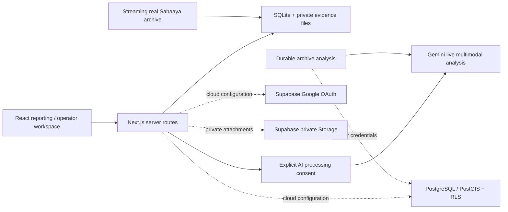

# CivicLens · Bengaluru

A transparent civic grievance and infrastructure triage system for Bengaluru. Residents report with a photo or voice note, AI rates the severity, the issue is routed to the responsible authority, and a public dashboard shows what happens next. Built with Next.js 16, React 19, TypeScript, MapLibre GL, AI SDK 7 and Workflow SDK 5. Local reporting works without cloud credentials. Cloud mode uses Supabase Auth, PostgreSQL/PostGIS and private Storage, with an operator queue and citizen-confirmed closure. A Docker deployment and [hosting guide](docs/HOSTING.md) are included.

## Problem and audience

Residents reporting damaged streets, water leaks, waste, and electrical hazards need a clear record of the evidence and what happened next. An administrative “closed” status alone does not demonstrate a repair. CivicLens serves Bengaluru residents and project review operators by connecting private visual/audio evidence, conservative triage, a review queue, and citizen-confirmed closure.

The existing Sahaaya archive supplies historical context; it is not a live incident feed. Project queues and handoff exports do not imply an integration with BBMP or another authority.

See the [submission draft](docs/SUBMISSION.md) and [hackathon compliance audit](docs/HACKATHON_COMPLIANCE.md) for verified capabilities, remaining submission items, and the live-demo checklist.

## Run locally

Requires **Node.js 24** (the local backend uses `node:sqlite`).

```powershell
npm ci
Copy-Item .env.example .env.local
npm run data:import
npm run dev
```

Open **http://127.0.0.1:3000**. On macOS/Linux use `cp .env.example .env.local`.

The import streams 5,000 real Sahaaya records from the public [Bengaluru citizen grievances dataset](https://github.com/Vonter/bbmp-citizen-grievances). It requires internet access and saves records into ignored `.data/civiclens.sqlite`. Subsequent local browsing/reporting works against that database; the street basemap still requires internet.

```sh
npm test
npm run typecheck
npm run build
npm run test:integration
npm start
```

Build uses Next.js's webpack compiler for reliable Workflow SDK integration. Integration tests run the actual production server against a separate, randomly named database under `.data/verification/`; their clearly identified test records never enter the citizen workspace.

## What works locally

- Database-backed archive metrics, search/category filtering, case inspection and source attribution.
- Bengaluru street map. Imported records have ward names, not exact coordinates, so no archive pins are drawn. Citizen reports appear publicly at a location rounded to about a kilometre.
- A public accountability dashboard with reports routed, acknowledged and confirmed per authority.
- Private browser receipt sessions: cryptographically random HttpOnly cookies, with only hashed tokens stored server-side. This is explicitly anonymous local ownership, **not** simulated Google sign-in.
- Create real reports with verified Bengaluru coordinate bounds and a tracking ID. Five submissions per receipt per hour.
- Private photo/audio attachments (5 MB maximum), microphone recording capped at 60 seconds, protected playback and downloads.
- Local review queues and audited transitions: Submitted → Acknowledged → In progress → Handoff prepared/Resolution proposed → Closed or Reopened. A resolution proposal requires image evidence. Local actions do not represent government acceptance or work.
- Handoff packet export without exact coordinates or private attachment bytes.
- Report form with a Bengaluru map picker, an optional photo and optional AI analysis in one step.
- Accountability insights computed from the archive: source closure share by category and ward label.
- Optional live Gemini analysis of text, photographs and English audio, with evidence IDs, transcription, uncertainty and explicit consent. **Requires your own Gemini key. No fabricated AI output is provided.**

## Data integrity

The source dataset is maintained by Vonter under ODbL and attributes its upstream records to Bengaluru Smart City Limited/Sahaaya. The imported window is historical, not an authoritative real-time government feed. Original dates and source statuses are preserved. Distinct ward labels are not counted as current official wards. Source closure does not prove a field repair.

No citizen examples, made-up coordinates, fabricated dashboard counts or canned model responses ship in the application. Automated test inputs are isolated from the running citizen database.

## Configuration

Keep all credentials in ignored `.env.local`; commit only `.env.example`.

- `CIVIC_LOCAL_MODE=true`: local receipt sessions and SQLite. The supplied start scripts bind to loopback. **Do not publicly expose this local workspace mode.**
- `GEMINI_API_KEY`: your Google AI Studio key for optional real inference. `GEMINI_MODEL` defaults to `gemini-3.8-flash`; verify availability and quota in your account.
- `APP_ORIGIN`: the public HTTPS origin for cloud mode.
- `SUPABASE_URL`, `SUPABASE_PUBLISHABLE_KEY`: runtime Supabase connection; `NEXT_PUBLIC_SUPABASE_*` aliases remain supported.
- `SUPABASE_SECRET_KEY`: server-only worker credential required by cloud AI analysis and maintenance. Never prefix this with `NEXT_PUBLIC_`.
- `CIVIC_DATA_DIR`: optional local database/evidence directory; leave unset for the usual `.data` directory.

Google OAuth requires enabling the Google provider in your own Supabase project and allowlisting `/auth/callback` for localhost and your deployed origin. Google sign-in and live inference cannot be verified until those external credentials are configured.

## Hosting yourselves

Follow [docs/HOSTING.md](docs/HOSTING.md) for migrations, Google OAuth, operator membership, runtime environment variables, real archive import, Docker/Node hosting, health checks and maintenance.

Cloud mode includes private report/evidence access through PostgreSQL RLS and Storage policies, bounded image/audio uploads, immutable evidence, audited operator actions, resolution photographs from the current review cycle, citizen-only confirmation/reopening, private exports and optional live multimodal AI. The UI adapts to local versus cloud sessions and exposes the review queue only to designated operators. Source and native report AI share a daily budget of 20 analyses per user and 50 for the project, counting failed attempts.

The supplied container setup supports one persistent application instance. Supabase stores all citizen data; the optional archive-analysis workflow uses a durable local volume. For multiple replicas use a supported shared workflow backend. No external authority dispatch occurs automatically.

GitHub Actions runs `npm run test:cloud` against an isolated real Supabase stack. Test users and media are confined to that disposable backend; tests refuse hosted Supabase URLs. The suite does not claim to verify an unconfigured Google OAuth client or Gemini account.

## Architecture



`src/lib/routing.ts` assigns each report to the responsible authority. `src/lib/triage.ts` holds safety rules that set a severity floor. Gemini rates severity from the evidence and can raise a rating but not lower that floor. It does not verify structural safety, quantify contamination or confirm government action. Handoff packets are prepared for each authority; nothing is delivered to them automatically.

The code is MIT licensed. Upstream data retains its separate ODbL license. Raw imported data, private reports, evidence, receipt tokens and credentials are excluded from Git.
