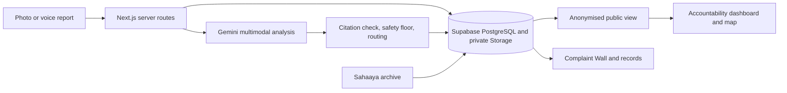

# CivicLens

**Closed isn't fixed.** CivicLens is a transparent civic grievance and infrastructure triage system for Bengaluru. Report a problem with a photo or your voice, and AI rates how serious it is. The right authority is assigned, and the whole city can see what happens next.

[Live site](https://civiclens-bengaluru.vercel.app) | [Design notes](docs/DESIGN.md) | [Hosting guide](docs/HOSTING.md)


Built for the Forge '26 Gen AI Buildathon under the Civic Pulse, Digital Governance & Public Information theme.

## The problem

In the 5,000 Bengaluru complaints we imported from the public Sahaaya archive, the source marks 1,573 as closed. Nothing in that record shows whether anyone checked the street afterwards. A status is an administrative action, not evidence of a repair.

Residents also face a practical question before they can complain at all: which of the city's bodies is responsible for this?

## How it works

1. **Show it or say it.** Add a photo or a voice note and place the issue on a map. No account is needed, and typing is optional.
2. **AI rates the severity.** Gemini reads the photo, voice and text together, then rates the issue from Critical to Low with its reasons and what it is unsure about.
3. **It reaches the right desk.** CivicLens assigns the responsible authority and prepares a handoff packet addressed to them.
4. **The city can watch.** The public dashboard shows each authority's reports, response time and confirmed repairs.
5. **Closing takes proof.** A reviewer must attach a photo of the repair, and only the person who filed the report can confirm it or reopen it.

## What's inside

- **The Complaint Wall:** every archive complaint drawn as one square, solid if marked closed. Hover to read the record, click to open it, or filter by type.
- **Accountability dashboard:** live figures for each authority, a public feed and map pins, alongside closure rates by department from the archive.
- **Records:** the full archive, searchable by issue, ward or complaint number.
- **My reports:** a stamp trail for each report, with evidence, review history and a downloadable handoff packet.

### Where reports go

| Issue | Authority |
|---|---|
| Road and bridge damage, obstructions | City corporation: roads |
| Water leaks, sewage, overflowing manholes | BWSSB |
| Stormwater drains | City corporation: stormwater drains |
| Waste | BSWML |
| Pollution | KSPCB |
| Hanging wires, power faults | BESCOM |
| Street lights | City corporation: street lights |

City corporations sit under the Greater Bengaluru Authority, which replaced the BBMP.

### AI guardrails

- **Safety floor:** deterministic rules set a minimum severity. Gemini can raise a rating, but it can't talk down an open manhole or a live wire.
- **Source attribution:** each observation must cite a supplied piece of evidence. Answers citing anything else are rejected.
- **Separated claims:** what is visible, what was reported and what was inferred are labelled separately, with uncertainty stated.
- **No simulated output:** if the model is unavailable, the app says so and the report stays saved.
- **Consent and limits:** evidence goes to Google only with permission, and daily analysis budgets apply. Every rating is provisional.

### Roles and access

Staff sign in with a password from the page footer. Access is enforced by row-level security in the database, so it holds even for direct API calls.

| Role | Can see | Can do |
|---|---|---|
| Citizen or guest | Their own reports and the public dashboard | File reports, confirm or reopen their own |
| Officer | Reports routed to their authority | Move those reports through review and propose a resolution |
| Admin | Every report | The same, for every authority |

### Privacy

Reports are public in summary only. The dashboard shows the issue type, severity, authority, status and a location rounded to about a kilometre. Descriptions, photos, voice notes, identities and exact locations stay private, and an integration test checks that they never reach the public view.

## Architecture



| Layer | Technology |
|---|---|
| Interface | Next.js 16, React 19, TypeScript, MapLibre with OpenStreetMap |
| Data | Supabase Auth, PostgreSQL with PostGIS and row-level security, private Storage |
| AI | Gemini through AI SDK 7, with Workflow SDK 5 for durable archive analysis |
| Hosting | Vercel, with checks in GitHub Actions |

## Run it locally

You need Node.js 24. Local mode uses SQLite, so no cloud accounts are required.

```bash
npm ci
```
```bash
cp .env.example .env.local
```
```bash
npm run data:import
```
```bash
npm run dev
```

Then open http://127.0.0.1:3000. The import needs internet access and downloads 5,000 real records into an ignored `.data` folder. To try AI analysis, add your own `GEMINI_API_KEY` to `.env.local`.

To host it yourself, follow the [hosting guide](docs/HOSTING.md).

## Tests

```bash
npm test
```
```bash
npm run typecheck
```
```bash
npm run build
```
```bash
npm run test:integration
```

Integration tests run the production server against a separate database, so test records never mix with real ones. GitHub Actions also runs `npm run test:cloud` against a disposable Supabase stack.

## Project layout

```
src/app          Pages and API routes
src/components   Interface, including the wall, report form and dashboard
src/lib          Routing, severity, analysis and data access
src/workflows    Durable archive analysis
supabase         Database migrations and row-level security
scripts          Archive import and integration tests
docs             Design notes, hosting and submission material
```

## Data

Records come from the [Bengaluru citizen grievances dataset](https://github.com/Vonter/bbmp-citizen-grievances) maintained by Vonter, which attributes them to Bengaluru Smart City Limited. They are stored in a live database. It is a historical archive covering 17 to 21 August 2026, not a live government feed. Every figure on the site is calculated from the database, with no sample data.

## Current limits

- CivicLens is an independent project. It assigns an authority and prepares a packet, but nothing is delivered to any authority automatically, and no authority has endorsed it.
- Reports name the city corporation in general. Choosing one of the five corporations needs their boundary data.
- AI accuracy, adoption and repair outcomes have not been measured.
- Live reporting and AI on the hosted site are still being switched on. See the [compliance notes](docs/HACKATHON_COMPLIANCE.md).

## Team

Team Re-zero: R Dharmendra, R Saravanan and Karthikeyan R S.

## Licence

The code is under the [MIT License](LICENSE). The archive data keeps its separate ODbL licence.
