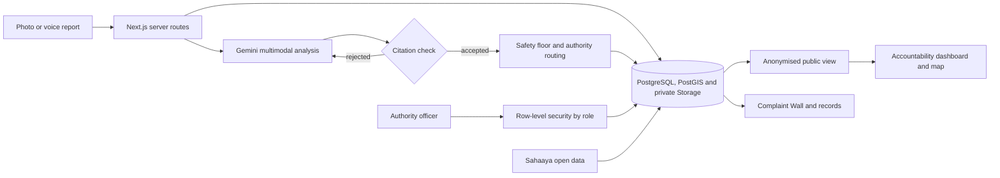

# CivicLens

**Closed isn't fixed.** A transparent civic grievance and infrastructure triage system for Bengaluru. Report a problem with a photo or your voice, and AI rates how serious it is. CivicLens assigns it to the responsible authority's review queue, and the whole city can see what happens next.

**Live app:** https://civiclens-bengaluru.vercel.app


Forge '26 Gen AI Buildathon, Civic Pulse, Digital Governance & Public Information track. Team Re-zero: R Dharmendra, R Saravanan and Karthikeyan R S.

## Problem

In the 5,000 Bengaluru complaints we hold from the public Sahaaya archive, the source marks 1,573 as closed. Nothing in that record shows whether anyone checked the street afterwards. A status is an administrative action, not evidence of a repair.

Residents also have to work out which body is responsible before they can complain at all. Bengaluru's roads, water, power, waste and pollution sit with different authorities.

**Who it affects:** Bengaluru residents reporting issues, and the officers responsible for resolving them.

## Solution

1. **Show it or say it.** A resident adds a photo or a voice note and places the issue on a map. No account is needed, and typing is optional.
2. **AI rates the severity.** Gemini reads the photo, voice and text together, transcribes speech, and rates the issue from Critical to Low with its reasons and what it is unsure about.
3. **It joins the right review queue.** The report is assigned to the responsible body's queue in CivicLens, with a handoff packet to download. CivicLens does not deliver it to the authority.
4. **Officers work a scoped desk.** Each officer signs in and sees only their authority's reports, most serious first.
5. **The city can watch.** A public dashboard shows each authority's reports, response time and confirmed repairs.
6. **Closing takes proof.** An officer must attach a photo of the repair, and only the person who filed the report can confirm it or reopen it.

### What makes it different

Most grievance portals record a status. CivicLens treats closure as a claim that needs evidence. The **Complaint Wall** shows every archive complaint as one square, solid if marked closed, so the scale of the gap is visible at once.

## AI reasoning and guardrails

- **Multimodal analysis:** one structured call reads images, audio and text together, and returns severity, category, transcript, observations and uncertainty.
- **Self-correction:** an answer that fails a check goes back to the model with a note on what to fix. A slow or failed call moves to the next attempt, and the slower, more thorough model is the last resort.
- **Source attribution:** every observation must cite a supplied piece of evidence. Answers citing anything else are rejected.
- **Safety floor:** deterministic rules set a minimum severity. AI can raise a rating, but it can't talk down an open manhole or a live wire.
- **Separated claims:** what is visible, what was reported and what was inferred are labelled separately.
- **Graceful failure:** if AI is unavailable, the report stays saved, keyword rules still route it, and the app says so. It never shows simulated results.
- **Durable workflow:** archive analysis runs as retryable read, extract and persist steps with recorded failure.

## Architecture



| Layer | Technology |
|---|---|
| Interface | Next.js 16, React 19, TypeScript, MapLibre with OpenStreetMap |
| Data | Supabase Auth, PostgreSQL with PostGIS and row-level security, private Storage |
| AI | Gemini Flash-Lite and Gemini 3.8 Flash through AI SDK 7, Workflow SDK 5 |
| Hosting | Vercel, with GitHub Actions checks |

**Dataset:** the [Bengaluru citizen grievances dataset](https://github.com/Vonter/bbmp-citizen-grievances) maintained by Vonter under ODbL, which attributes the records to Bengaluru Smart City Limited. We store 5,000 records in a live database. It is a historical archive covering 17 to 21 August 2026, not a live government feed. Every figure on the site is calculated from the database.

### Authority routing

| Issue | Authority |
|---|---|
| Road and bridge damage, obstructions | City corporation: roads |
| Water leaks, sewage, overflowing manholes | BWSSB |
| Stormwater drains | City corporation: stormwater drains |
| Waste | BSWML |
| Pollution | KSPCB |
| Hanging wires, power faults | BESCOM |
| Street lights | City corporation: street lights |

City corporations sit under the Greater Bengaluru Authority, which replaced the BBMP.

### Roles and access

Administrators issue staff accounts from the `/admin` page, and officers sign in at `/staff`. Each department has a public queue at `/department`, showing anonymised data; private details need a staff sign-in. Access is enforced by row-level security in the database, so it holds even for direct API calls.

| Role | Can see | Can do |
|---|---|---|
| Citizen or guest | Their own reports and the public dashboard | File reports, confirm or reopen their own |
| Officer | Reports assigned to their authority | Move those reports through review, propose a resolution |
| Admin | Every report | The same, for every authority |

### Privacy

The public dashboard shows only the issue type, severity, authority, status and a location rounded to about a kilometre. Descriptions, photos, voice notes, identities and exact locations stay private, and an integration test checks that they never reach the public view.

## Setup

You need Node.js 24. Local mode uses SQLite, so no cloud accounts are required.

```bash
npm ci
```
```bash
cp .env.example .env.local
```
```bash
npm run data:import
```
```bash
npm run dev
```

Then open http://127.0.0.1:3000. The import needs internet access and downloads 5,000 real records. To use AI analysis, add your own `GEMINI_API_KEY` to `.env.local`. Staff sign-in needs cloud mode.

To deploy with Supabase and Vercel, follow the [hosting guide](docs/HOSTING.md).

## Tests

```bash
npm test
```
```bash
npm run typecheck
```
```bash
npm run build
```
```bash
npm run test:integration
```

Integration tests run the production server against a separate database. GitHub Actions also runs `npm run test:cloud` against a disposable Supabase stack, including attempts by one authority's officer to reach another authority's reports.

## Project layout

```
src/app          Pages and API routes
src/components   Interface, including the wall, report form and authority desk
src/lib          AI analysis, routing, severity, accountability and data access
src/workflows    Durable archive analysis
supabase         Database migrations and row-level security
scripts          Archive import and integration tests
tests            Unit tests
```

## Limits and roadmap

- CivicLens is an independent project. It assigns an authority and prepares a packet, but it does not deliver to any authority, and no authority has endorsed it.
- AI ratings are provisional and need human verification. Accuracy, adoption and repair outcomes have not been measured.
- **Next:** official authority integration, routing to the five city corporations using ward boundaries, more languages, and measured accuracy from a pilot.

## Licence

The code is under the [MIT License](LICENSE). The archive data keeps its ODbL licence.
